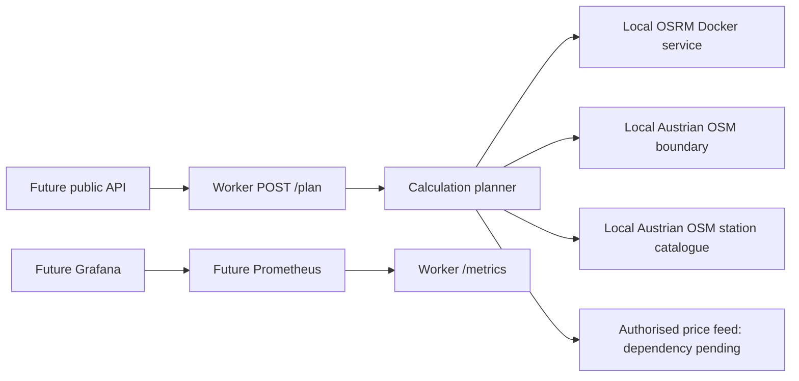

# Fuel-stop worker walkthrough

## Responsibility and boundary

The future public API calls synchronous `POST /plan` on this private worker.
The worker has no database credentials and stores no trips. Kubernetes can run
multiple copies of the same image. The future map draws `route.geometry`, a
GeoJSON LineString in **longitude, latitude** order. Text addresses and geocoding
belong in the future public API/UI; this contract accepts coordinates.

| File | Purpose |
|---|---|
| `fuel_stop/models.py` | Inputs, station, route, quote and result models; reject invalid or unknown fields |
| `fuel_stop/planner.py` | Provider-independent feasibility and ranking logic |
| `fuel_stop/providers.py` | Local OSRM, optional Overpass and authorised-feed HTTP adapters |
| `fuel_stop/stations.py` | Default local station retrieval, range/fuel/country filtering |
| `fuel_stop/boundary.py` | Local Austrian point and full-route geometry checks |
| `scripts/prepare_osrm.py` | Verified downloads, country assembly and Docker MLD preparation |
| `fuel_stop/app.py` | `/plan`, health endpoints, metrics and dependency error mapping |
| `tests/fixtures/trips.json` | Saved synthetic scenarios with expected results |
| `tests/test_planner.py` | Offline replay providers and calculation tests |
| `tests/test_providers.py` | HTTP contract, invalid feed and endpoint tests |

## Input

`examples/trip.json` is a Vienna-to-Graz request. Fuel type is `diesel` or
`petrol95` (OSM `fuel:octane_95=yes`). All fuel values are litres and consumption
is L/100 km. `minimum_buffer_l` defaults to 1 litre and governs arrival at the
station. `arrival_reserve_l` governs arrival at the destination. They are separate
requirements. Omit `max_detour_km` to impose no detour limit; zero allows no added
distance. Current fuel, buffer and reserve must fit in the tank.

Before routing, a local OSM Austrian country polygon checks both endpoints. The
OSRM adapter also checks every snapped waypoint and the entire full-resolution
route LineString against that polygon. A country extract may contain foreign
roads: downloading Austria alone is not the border restriction. See
[ADR 0002](adr/0002-local-osrm.md) for conservative near-border behavior.
The model assumes a constant consumption rate on every road segment. Normal
station lookup uses the dated local PBF catalogue, not an online Overpass call.
[Station retrieval](station-retrieval.md) documents preparation and source freshness.

## Routing adapter contract

`OSRMRouter` calls `GET /route/v1/driving/lon,lat;lon,lat[;lon,lat]` on the local
server with `overview=full`, `geometries=geojson`, `steps=false`,
`alternatives=false` and a 100 m snapping radius for each point. The graph is
prepared with OSRM's car profile. Two points give one leg; adding a stop gives
two legs and one consistent route geometry. The adapter converts meters to km,
preserves duration in seconds, and produces the existing `Route` model.

Malformed results, non-finite/negative values, missing legs, inconsistent leg
sums, excessive snapping and missing geometry fail explicitly. `NoRoute` and
`NoSegment` are genuine no-route outcomes; transport failures remain
`routing_unavailable`. The known public OSRM demo hostname is refused as a
configuration value. There is no provider fallback and no routing key.

## Calculation, step by step

Let `c = consumption_l_per_100km / 100` in L/km.

1. Fetch the direct road route of distance `D`. If `current - c*D >= reserve`,
   return `direct`, zero purchase cost and the direct geometry. Do not fetch stations
   or prices. Country checks are local; no station-source access is needed.
2. Find public Austrian OSM fuel stations with an explicit matching fuel tag and
   `opening_hours=24/7`. Search the straight-line range that could be reached
   before using the station buffer, plus a 1 km snapping allowance. This is a
   candidate prefilter only; it does not establish road reachability.
3. For each candidate, request a **single road route through its waypoint**. OSRM
   returns two leg distances `d1` and `d2` and the full map geometry. Using one
   request ensures the geometry, legs, time and calculations describe the same route.
4. Fuel at the station is `at_station = current - c*d1`. Reject if below the buffer.
   Detour is `max(0, d1+d2-D)`. Reject if above the supplied detour limit.
5. Calculate `buy = max(0, c*d2 + reserve - at_station)`. Round upward to the next
   0.001 litre. Reject if `at_station + buy > tank_capacity`.
6. For each feasible station, use a matching authorised quote no older than one
   hour. Reject future or timezone-free timestamps. Use the most recent quote.
7. Rank by the **unrounded** `buy * price`, then total route fuel use, then driving
   seconds, then station ID for deterministic output. Display cost rounded to cents.

The objective is **money paid for this trip's necessary refill**. Existing fuel is
already owned. No extra top-up, toll, labour, electricity, second stop or fuel-price
forecast is included. The direct route is the provider's normal driving route;
this does not optimise every possible road path globally.

## Worked example

The saved scenario has a 200 km direct route, 8 L currently in the tank,
6 L/100 km consumption, a 3 L destination reserve and a 40 L tank.

Direct arrival would be `8 - 200*0.06 = -4 L`, so a stop is required.

| Candidate | Road legs | Total fuel used | Required purchase | Pump price | Purchase cost |
|---|---|---|---|---|---|
| cheap-pump | 60 + 170 km | 13.8 L | 8.8 L | EUR 1.50/L | EUR 13.20 |
| best-cost | 80 + 120 km | 12 L | 7 L | EUR 1.60/L | EUR 11.20 |

At best-cost the driver has `8 - 80*0.06 = 3.2 L`, buys 7 L, then uses
`120*0.06 = 7.2 L`, arriving with exactly 3 L. The higher pump price wins because
it avoids buying fuel to cover the detour. Reproduce with
`uv run --frozen python -m tests.test_planner` from the repository root.

Decimal calculations avoid binary floating-point surprises. Numeric output fields
are JSON strings because Pydantic preserves Decimal precision; the map/API client
can explicitly convert them to numbers for display. Coordinates are numeric.

## Result states

| HTTP | Status | Meaning |
|---|---|---|
| 200 | `direct` | No stop needed with the requested reserve |
| 200 | `stop` | Best priced feasible candidate, with route, station, purchase, arrival fuel, detour and quote time |
| 200 | `no_feasible_stop` | No returned candidate satisfies the single-stop constraints |
| 200 | `prices_unavailable` | Feasible stops exist, but no usable price quote exists |
| 422 | `outside_austria` | Endpoint outside the Austrian area |
| 422 | `no_route` | No direct driving route returned |
| 422 | `border_restricted_route` | OSRM's direct route leaves Austria; a different domestic route might exist |
| 422 | validation details | Invalid input |
| 503 | `routing_unavailable` | Local OSRM call failed or returned invalid data |
| 503 | `boundary_unavailable` | Local country boundary missing or invalid; never bypass the check |
| 503 | `stations_unavailable` | Local catalogue missing/invalid, or explicit online station query failed |
| 503 | `station_capacity_unavailable` | More than 200 candidates; nothing silently truncated |

Business outcomes are at the JSON top level. HTTP errors use FastAPI's `detail`
object. A routing failure while comparing any candidate aborts the plan; choosing
from an incomplete set would hide a potentially cheaper stop. A genuine no-road
result for one station only excludes that station. A station whose returned
route crosses a border is likewise excluded. The comparison covers OSRM's
returned routes, not all possible domestic road alternatives.

`stations_compared` counts matching, known-24/7 candidates whose road routes were
evaluated, including unreachable candidates. `feasible_stations` counts those that
pass fuel and detour constraints. `priced_stations` counts feasible stops with a
fresh usable quote. `ranking_complete=false` means some feasible stops have unknown
prices; the UI must say "best among priced candidates", not "cheapest overall".

## Honest limits of this first component

OSM is incomplete and can be outdated. Unknown fuel availability, unknown opening
hours and private access are excluded. A 24/7 tag is not proof of live pump service,
compatible payment or absence of temporary closure. Exact opening-hours evaluation,
live service status and payment restrictions need additional station data. The
current result states its restricted station scope rather than claiming to compare
every Austrian station. OSM can represent one facility as several objects; the
authorised feed must map its station IDs correctly and resolve duplicates.

Requests use bounded HTTP timeouts but evaluate stations sequentially, up to 200.
There is no whole-job deadline, routing cache, rate-limit scheduler or durable queue
yet. Local routing removes hosted-routing quotas but still uses CPU and memory;
Optional Overpass diagnostics and price-source quotas remain. Keep this worker private and test a
small case first. Before general live use, measure call counts, add caching/batching
and define a whole-job deadline with the future API.

Saved cases intentionally use synthetic data with an explicit `replay` label.
They prove calculations and contracts. They do not prove live provider coverage or
licensed Austrian price availability. No fallback from a failed live request to a
successful replay result occurs.

## References

- [OSRM route API contract](https://project-osrm.org/docs/v5.24.0/api/#route-service)
- [OSRM Docker preparation](https://github.com/Project-OSRM/osrm-backend)
- [Overpass area queries](https://dev.overpass-api.de/overpass-doc/en/full_data/area.html)
- [OSM licence and attribution](https://www.openstreetmap.org/copyright)
